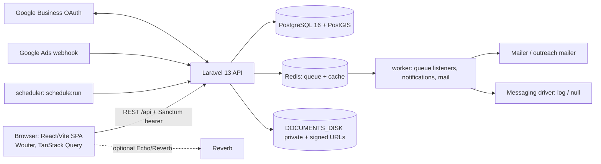
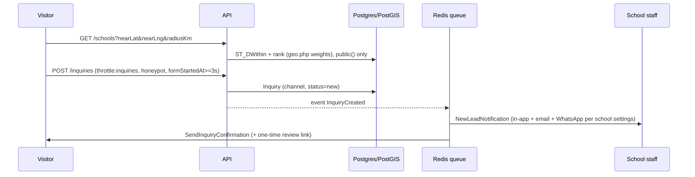
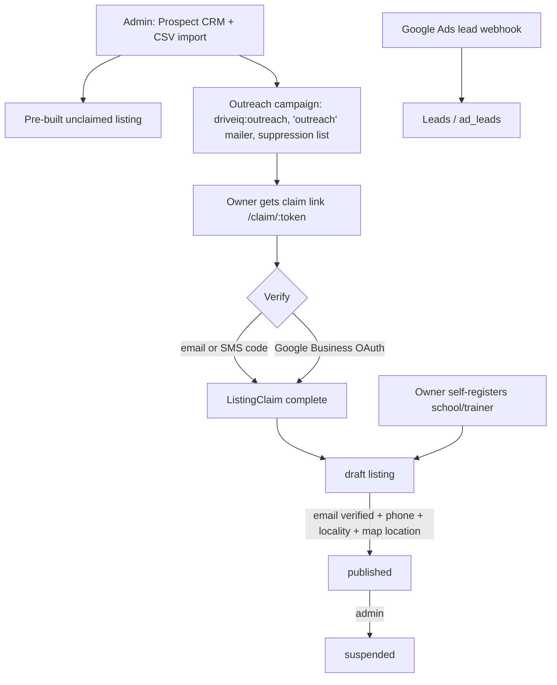

# DriveQ — System Flow (reverse-engineered)

**Verified against code:** 2026-10-31 (`backend/routes/api.php`, `routes/console.php`, `app/`, `config/`, migrations, `frontend/src/App.tsx`, CI and compose files).
This document describes what the code does. Status of record for scope is still `PROJECT-PLAN.md` section 2.

## 1. Runtime topology



Compose services: `postgres`, `redis`, `backend`, `worker`, `scheduler`, `frontend` (local file and `docker-compose.prod.yaml`). CI: Pint, migrate, PHPUnit on `postgis/postgis:16-3.4`, then frontend `pnpm typecheck` and `pnpm build` (PHP 8.3, Node 22). There is no deploy job yet (M11).

## 2. Actors and access

| Actor | `users.role` | Scope | Frontend area |
|-------|--------------|-------|---------------|
| Visitor | none | public endpoints (filter explicitly, `School::public()`) | `/`, `/search`, `/school/:slug`, `/locality/:slug`, `/compare` |
| Learner | `learner` | own record, own school's data after enrolment | `/learner/*` |
| Instructor/trainer | `instructor` | assigned learners, own docs/leave | `/instructor/*` |
| School owner / manager | `school` (owner vs manager via `school_admins`) | one `school_id`; owner-only: team, billing, settings | `/dashboard/*` |
| Platform admin | `admin` (created by `driveiq:create-admin`) | everything | `/admin/*` |

Enforcement chain: `auth:sanctum` then `RoleMiddleware` (`role:...`) then `EnforcePlanFeatures` (`plan.features`, from `config/plans.php`) then `SchoolAccess` in the controller, with `BelongsToSchool` as the model-level backstop and `SchoolScopedIds` for foreign IDs.

## 3. Core flows

### 3.1 Search to enquiry to notification



### 3.2 Lead to learner to operations

```
new -> contacted -> follow-up -> interested -> converted | lost      (LeadStatusHistory, LeadNote, follow-up dates)
                                         |
                POST /inquiries/{id}/convert  -> Learner (school_id, package, assigned trainer/vehicle)
                                         v
 Schedule (trainer + vehicle + learner, clash checks, locked bookings) -> Attendance -> TrainingProgress
 -> DrivingTest -> license status;  Payment (pending -> paid|failed);  LearnerDocument (private, signed link)
```

Cron support: `driveiq:lead-reminders` (15 min, unanswered leads), `driveiq:ops-reminders` (hourly: sessions 24h/2h, licence and vehicle paper expiry, missing documents), response-badge refresh (hourly).

### 3.3 Reviews

Eligible reviewer = enrolled learner, or holder of the one-time link from the inquiry confirmation (`ReviewEligibilityService`). Reports (`POST /reviews/{id}/report`) auto-hide at 3; admin moderates; school rating recomputed (`School::recalculateRating`).

### 3.4 Supply side: onboarding, claim, acquisition



`listing_status`: unclaimed, draft, published, suspended; only published is public. Types: `school`, `trainer`. Landing pages `/for-schools`, `/for-trainers` carry UTM attribution into `schools`.

### 3.5 Billing and visibility

Every school starts a 30-day trial of Premium features (no paid visibility). `config/plans.php` maps plan to modules; locked module = reads allowed, writes 402 `plan_required`. Admin records a manual UPI/bank payment, `BillingService` produces GST `PlatformInvoice`; `driveiq:subscriptions` (03:15) sends notices and expires. Admin console shows MRR/ARR, churn, trials, slot use. `FeaturedPlacement` + `MarketplaceSetting` define capped, labelled sponsored slots and campaign windows. Razorpay is not integrated.

### 3.6 DPDP and audit

`Consent` rows (`POST /consents`, purposes revocable), `DataSubjectRequest` flow (public form `/privacy/data-request`, admin queue), `ContactMessage` inbox, `driveiq:retention` daily 02:30 (reports only unless `RETENTION_EXECUTE=true`). `AuditLog` is append-only (Eloquent guard + PostgreSQL trigger).

### 3.7 Messaging and realtime

In-app: `notifications` table, `NotificationService`, `NotificationCreated` broadcast on `user.{id}` / `school.{id}` (authorised in `routes/channels.php`); live only if Reverb is configured. WhatsApp/SMS: `MessagingService` -> `outbound_messages` -> `MessageSender` driver (`log`/`null`); opt-in is a consent record; templates and DLT ids in `config/messaging.php`. Internal chat: `MessageThread`/`Message` (`/messages/*`).

## 4. Data model (grouped, from `app/Models`)

- Identity: `User`, `SchoolAdmin` (owner/manager/invites), personal access tokens.
- Listing: `School` (type, listing_status, PostGIS `location`), `Locality`, `DrivePackage`, `SchoolSetting`, `MarketplaceSetting`, `Plan`, `Subscription`, `PlatformInvoice`, `FeaturedPlacement`.
- Leads/trust: `Inquiry`, `LeadNote`, `LeadStatusHistory`, `Review`, `ReviewReport`.
- Operations: `Learner`, `LearnerDocument`, `LearnerAssignmentHistory`, `Instructor`, `InstructorDocument`, `Vehicle`, `VehicleDocument`, `Schedule`, `Attendance`, `LeaveRequest`, `TrainingProgress`, `DrivingTest`, `Payment`.
- Communication: `AppNotification`, `MessageThread`, `Message`, `OutboundMessage`.
- Acquisition: `Prospect`, `ListingClaim`, `ListingClaimCode`, `OutreachCampaign`, `OutreachEnrollment`, `OutreachMessage`, outreach suppressions, ad leads, `GoogleBusinessConnection`.
- Compliance: `Consent`, `DataSubjectRequest`, `AuditLog`, `ContactMessage`.

## 5. Queues and schedule

Queued: `SendInquiryCreatedNotification`, `SendInquiryConfirmation`, notifications `NewLeadNotification`, `OnboardingInvite`, `PlanNoticeNotification`, mail. Scheduled commands are listed in `CLAUDE.md` section 4. Emails need a running `worker` and a real mailer.

## 6. Docs vs reality

| # | Doc says | Code/reality | Doc |
|---|----------|--------------|-----|
| 1 | "Express transitioning to Laravel" | Laravel-only; no Express code | old CLAUDE.md (fixed) |
| 2 | 5 roles incl. `school_owner`, `school_manager` as role values | `users.role` is admin/school/instructor/learner; owner/manager via `school_admins` | PBAC, PROJECT-PLAN s4, old CLAUDE.md |
| 3 | Audit (18 Aug): no `BelongsToSchool`, isolation CRITICAL, ops "not started" | Trait on all operational models, fail-closed; ops built | Audit Report docx, BACKEND-ASSESSMENT |
| 4 | Laravel 11 | Laravel 13 | DEPLOY.md |
| 5 | npm commands | pnpm (CI, lockfile, Makefile) | old CLAUDE.md |
| 6 | PROJECT-PLAN "Version 1.0, June 9" while section 2 dated 2026-10-02; phases 1,2,3,5-8 not 100% ticked | M1-M10 shipped; only some items open | PROJECT-PLAN header, old CLAUDE.md roadmap boxes |
| 7 | CLAUDE.md phase boxes (A-F) unticked for items now done (near-me consent flow and Pune seed remain; SEO/admin tooling open) | Mixed | old CLAUDE.md |
| 8 | Stores `locationStore`, `regulationStore`, `governmentResourceStore` | Zustand in `features/geo-rules/stores/location-store.ts`, `features/comparison/stores/comparison-store.ts`, `lib/store.ts` | old CLAUDE.md |
| 9 | Table names `leads`, `lead_activities`, `learners`, `instructors`, `school_listings`, roles/permissions tables | `inquiries`, `lead_notes`, `lead_status_history`; no roles/permissions tables; no `school_listings` | ARCHITECTURE, Core-Business-ERd, PRD-DSOS |
| 10 | Redis/Reverb real-time as plan | Events, channels, `notifications`, Echo helper exist; `BROADCAST_CONNECTION=log` default | Message Broker plan docx |
| 11 | Backlog.xlsx (Aug) lists phases 3-9 as open | Shipped (see DriveQ-Backlog.xlsx ledger) | DriveIQ-Backlog.xlsx |
| 12 | Haversine geo distance | PostGIS `ST_DWithin`, trigger-synced `geography` | Audit Report |
| 13 | "Mock pages" / skeleton compare | Compare API and page real | Audit Report |
| 14 | Project plan says Features and PRD docs are "superseded" by PROJECT-PLAN | Feature specs (Geo-Aware, Comparison, Google Business) are still the only detailed specs | PROJECT-PLAN intro |
| 15 | Name "DriveIQ" | User-facing "DriveQ"; code keeps `driveiq` | many docs, docx/xlsx/pptx/html filenames |
| 16 | Duplicate "Phase" and section numbering (two section 5s, 4.x under 4) | Cosmetic | old CLAUDE.md (fixed) |

Also note: `docs/ROADMAP.md` and the October docs are untracked in git; `docs/files.zip` was deleted in the working tree.

## 7. Recommended doc cleanups (not applied)

1. Bump PROJECT-PLAN header (version/date) and tick phase checklists to match section 2; keep it as the only status doc.
2. Add a "Historical" banner to BACKEND-ASSESSMENT, PHASE-A-IMPLEMENTATION, the Aug Audit Report and DriveIQ-Backlog.xlsx (or move to `docs/archive/`).
3. Fix DEPLOY.md: Laravel 13; add worker/scheduler/Reverb notes and the M11 gaps.
4. Update PBAC.md and PROJECT-PLAN s4 with the real role model (four role values plus owner/manager).
5. Replace aspirational table lists in ARCHITECTURE.md and Core-Business-ERd.md with the real schema (or generate from migrations).
6. Add status lines (Built / Partial / Planned) to Geo-Aware, PRD-Google-Business and the persona docs.
7. Pick one product spelling for new docs (DriveQ) and rename the docx/xlsx/pptx files when convenient.
8. Commit or ignore the untracked docs; decide whether `docs/files.zip` deletion is intended.
9. Add a short `docs/README.md` index pointing to PROJECT-PLAN, ROADMAP, this file.
